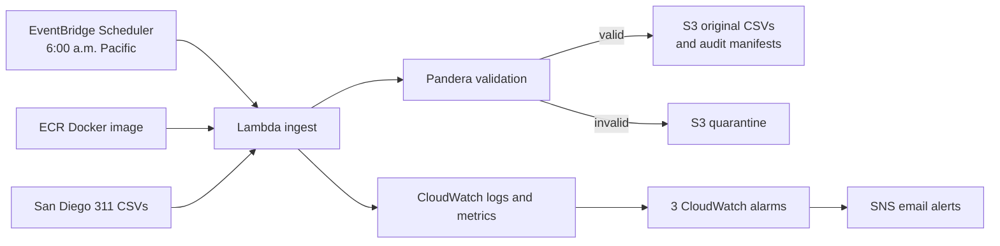

# San Diego 311 Daily Prediction Pipeline

I started this project by looking at how long San Diego's Get It Done requests take to close. The notebook work grew into a repeatable pipeline: download the city's latest files, check their structure, keep the originals for auditing, and use historical requests to predict closure-time ranges.

**Current status:** The AWS ingestion path is deployed in `us-east-2`. I ran the new Lambda against live city files and verified its S3 outputs and alert delivery. The daily schedule is enabled; its first scheduled run is still pending. Databricks processing and GitHub deployment automation are later steps. See [AWS deployment evidence](sd311-pipeline/STATUS_AWS.md).

## What runs in AWS



Terraform defines the S3 bucket, ECR repository, Lambda, IAM roles, schedule, alarms, SNS topic, and budget. The Lambda image contains the Python code and dependencies; Terraform supplies its AWS settings and permissions. The original CSV and a manifest with its row count and SHA-256 hash are stored together. A file that fails the schema goes to `quarantine/` instead of continuing through the pipeline.

The current AWS-only deployment does not upload Parquet or start a Databricks job. Those steps are implemented behind a configuration switch and remain to be verified on a Databricks workspace.

## Live run and model results

On **November 9, 2026**, I manually invoked the new `sd311-main-ingest` Lambda and checked the resulting objects in the new S3 bucket:

| City file | Validated rows | S3 output |
| --- | ---: | --- |
| Open requests | 85,338 | Original CSV + `manifest.json` |
| Closed requests, 2026 | 358,943 | Original CSV + `manifest.json` |
| **Total** | **444,281** | **Two CSVs + two manifests** |

The invocation finished in about **13 seconds** and used **822 MB** of its 2,048 MB limit. Both files passed validation. I also verified the new SNS email subscription and a controlled CloudWatch alarm notification. The first **scheduled** invocation has not been observed yet. [Detailed checks](sd311-pipeline/STATUS_AWS.md).

Separately, the closure-time CatBoost model beat a per-service baseline in all five quarters of a rolling backtest on **456,265 held-out requests**: pooled macro-F1 was **0.531 vs. 0.432**. Each fold used a 300,000-row training sample from its time window; the model was not trained on every record in the full dataset. [Methods and per-quarter results](sd311-pipeline/ml/reports/RESULTS.md).

## Repository guide

| Path | What is there |
| --- | --- |
| [`sd311-pipeline/src/sd311/`](sd311-pipeline/src/sd311/) | Lambda ingestion, Pandera schema, settings, and monitoring code |
| [`sd311-pipeline/infra/`](sd311-pipeline/infra/) | Terraform for the current AWS deployment |
| [`sd311-pipeline/docker/`](sd311-pipeline/docker/) | Lambda container image |
| [`sd311-pipeline/ml/`](sd311-pipeline/ml/) | Closure-time model, tests, and backtest results |
| [`sd311-pipeline/lessons/`](sd311-pipeline/lessons/) | Step-by-step lessons and my explanation notes |
| [`sd311-pipeline/README.md`](sd311-pipeline/README.md) | Full architecture and local setup |
| [`archive/legacy-analysis/`](archive/legacy-analysis/) | Earlier EDA, district analysis, and regression notebooks |

## Try the code locally

```bash
cd sd311-pipeline
python3.12 -m venv .venv
source .venv/bin/activate
pip install -e ".[dev]"
python scripts/lessons.py check 4
python scripts/lessons.py check 5
```

The lesson checks run without AWS credentials. To deploy your own AWS copy, start with the [pipeline deployment guide](sd311-pipeline/README.md#deploy-manual-once-you-have-credentials) and use your own bucket names and alert email. Terraform state, credentials, local data exports, and `terraform.tfvars` are excluded from Git.

## Next

- Verify the first scheduled 6:00 a.m. Pacific run and then retire the older AWS schedule.
- Connect Databricks for Parquet landing, bronze/silver/gold processing, and daily scoring.
- Complete the CI/CD lesson before enabling automatic GitHub deployment.

Built by **Jaden Wu**.
