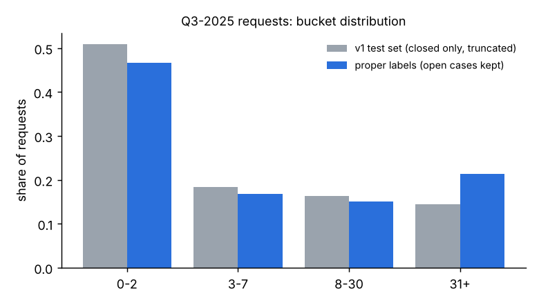
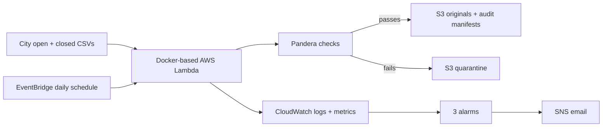
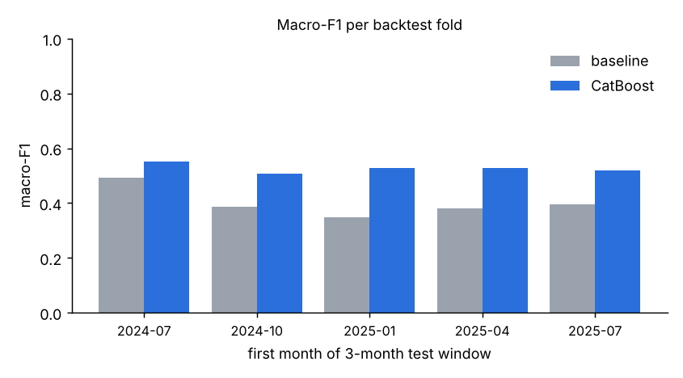

# San Diego 311: Predicting Service Delays With Better Data

When someone submits a Get It Done request to the City of San Diego, how long should they expect to wait? I’m building a tool that estimates a **closure-time range** from information available when the request is submitted: **0–2, 3–7, 8–30, or 31+ days**. I also want the underlying data to be reliable enough to track where delays build up over time.

The most important part of this project was finding that my first model answered an easier question than the real one. Its test set included only requests that had already closed, so it missed **22,940 of 180,360 requests submitted in the second half of 2025 (12.7%)**—all still open. Those missing requests were exactly the slow cases a useful predictor needs to handle. I rebuilt the evaluation around that finding, then started a daily AWS pipeline to keep the original city files and build a better history for future predictions.

## The problem I found

My early notebooks explored service delays and district differences. The first prediction model used closed-case files, which looked reasonable until I checked which requests were absent. In a July–September 2025 comparison, **31+ day requests were 14.4% of the old test set but 21.4% with the open cases included**. A model evaluated on the old set could look better simply because many slow requests never made it into the test.



That changed the target. An exact closure date would overpromise, especially for long-running cases. I now predict four time ranges, keep open requests in the data, assign a label only when its time range is certain, and test on later time periods. The [analysis behind the 12.7% finding](sd311-pipeline/ml/reports/old_vs_new.md) shows how I caught the bias.

## The tool I’m building

The goal is a request-time estimate someone could actually interpret: a likely range, based on the request’s service, location, timing, and recent workload. It should also let me check how those estimates change as the city’s backlog changes. The prediction model has been evaluated offline; there is **no public-facing predictor or live scoring service yet**.

The daily data pipeline is the foundation for that tool. A single snapshot cannot tell me whether a field was edited after submission. The AWS schedule is set up to save each day’s open and closed files. Over time, those snapshots can show how records changed, help me audit unexpected changes, and support future scoring without quietly using information added later.



Terraform defines the AWS resources and IAM permissions; ECR stores the Lambda image. The manifest beside each CSV records its row count and hash so I can check what the city sent on a given day. The planned Databricks stage will turn these snapshots into processing tables and daily model scores. [Pipeline code and architecture](sd311-pipeline/README.md).

## What I’ve verified

| Part | Result |
| --- | --- |
| Model backtest | CatBoost beat a per-service baseline in **all five quarterly test periods**, over **456,265 held-out requests**. Pooled macro-F1: **0.531 vs. 0.432**. |
| Live AWS ingestion | I manually ran the new Lambda against the city’s open and 2026 closed files: **444,281 rows** validated, with both CSVs and their manifests checked in S3. |
| Alerts | The new SNS subscription delivered a test message, and a controlled CloudWatch alarm test delivered an alarm email. |



Each backtest fold trained on a **300,000-row sample** from its earlier time window. The model result is an offline backtest, separate from the live AWS ingest. The new 6:00 a.m. Pacific schedule is enabled, but its first scheduled invocation has not yet been observed. Databricks processing and GitHub deployment automation are future work. The exact AWS checks are in [deployment evidence](sd311-pipeline/STATUS_AWS.md), and the model design and limitations are in [results](sd311-pipeline/ml/reports/RESULTS.md).

## Explore the project

| Path | What to look at |
| --- | --- |
| [`sd311-pipeline/src/sd311/`](sd311-pipeline/src/sd311/) | CSV download, validation, S3 landing, and monitoring code |
| [`sd311-pipeline/infra/`](sd311-pipeline/infra/) | Terraform for S3, ECR, Lambda, IAM, Scheduler, CloudWatch, and SNS |
| [`sd311-pipeline/ml/`](sd311-pipeline/ml/) | Point-in-time labels, features, CatBoost training, tests, and reports |
| [`sd311-pipeline/lessons/`](sd311-pipeline/lessons/) | The hands-on lessons and my notes explaining the code |
| [`archive/legacy-analysis/`](archive/legacy-analysis/) | The earlier notebooks that led to this version of the project |

To run the AWS lessons locally:

```bash
cd sd311-pipeline
python3.12 -m venv .venv
source .venv/bin/activate
pip install -e ".[dev]"
python scripts/lessons.py check 4
python scripts/lessons.py check 5
```

The [full setup guide](sd311-pipeline/README.md) covers the rest of the code. Large raw exports, AWS credentials, Terraform state, and local deployment settings are excluded from Git.
