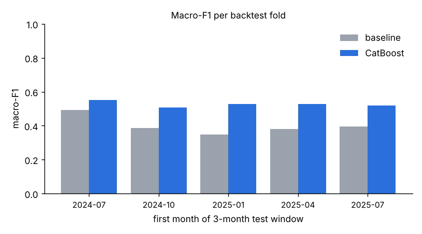
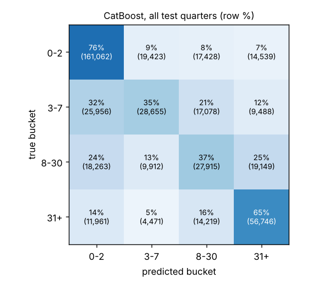
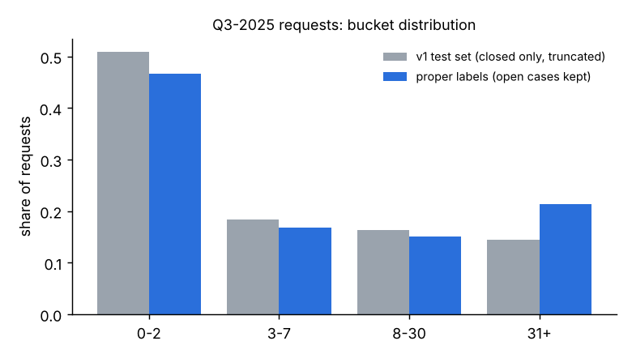

# Results: closure-time bucket model v2

All numbers below come from running the scripts in this repo on 2026-10-08
(`reports/backtest.json`, `reports/old_vs_new.json`, `reports/field_availability.md`).
The backtest and the final model were **re-run on 2026-10-08 (afternoon)** after a train/serve
skew fix in `label_final_at` (see "What changed" below). The field-availability, v1-vs-v2 and
ablation numbers come from the earlier run; they do not depend on that fix, except the ablation
(marked below).

## Setup in one paragraph
Target: bucket of `date_closed - date(date_requested)`, either `0-2`, `3-7`, `8-30` or `31+` days.
Labels are as of 2025-12-31, and open requests at least 31 days old count as `31+`
(`sd311_core/labels.py`). The data is 2.56 M cleaned requests (closed 2016-2025 plus the open
snapshot, extract date inferred as 2026-01-14). There are 22 features, all computable at
submission time (`sd311_core/features.py`). `service_name_detail` and `year` are excluded. The
backtest has 5 quarterly origins with test months 2024-07..2025-09. Each fold trains on a 24-month
window (300k-row sample), uses the last month as validation for early stopping and has a 31-day
embargo. The model is CatBoost MultiClass (depth 6, lr 0.15, up to 500 trees with early stopping,
no hyperparameter search). The baseline is each service's most common bucket among labels that became final in the 90 days
before the test period, with that mix as probabilities.

## Backtest: model vs baseline

| test quarter | n test | model macro-F1 | baseline macro-F1 | model acc | baseline acc | model log-loss | baseline log-loss |
|---|---|---|---|---|---|---|---|
| 2024-07 | 103,422 | 0.550 | 0.493 | 0.605 | 0.536 | 0.924 | 1.058 |
| 2024-10 | 83,116 | 0.508 | 0.386 | 0.597 | 0.524 | 0.900 | 1.069 |
| 2025-01 | 88,927 | 0.529 | 0.350 | 0.587 | 0.521 | 0.972 | 1.127 |
| 2025-04 | 85,904 | 0.528 | 0.380 | 0.621 | 0.554 | 0.881 | 1.022 |
| 2025-07 | 94,896 | 0.519 | 0.395 | 0.596 | 0.540 | 0.905 | 1.051 |
| **overall (pooled)** | **456,265** | **0.531** | **0.432** | **0.601** | **0.535** | **0.917** | **1.065** |

Per-class recall (pooled):

| bucket | share of test | model recall | baseline recall |
|---|---|---|---|
| 0-2 | 46.6% | 0.758 | 0.792 |
| 3-7 | 17.8% | 0.353 | 0.177 |
| 8-30 | 16.5% | 0.371 | 0.281 |
| 31+ | 19.1% | 0.649 | 0.462 |

(Baseline confusion matrix: `figures/confusion_baseline.png`.)

**Plain reading.** The model beats the per-service baseline in every fold on macro-F1, accuracy
and log-loss. Overall macro-F1 rises by +0.10 (0.43 to 0.53), accuracy by +0.07 and log-loss falls
by 0.148. The smallest gain is in the first fold (+0.06 macro-F1). The gain is all in the
`3-7`, `8-30` and `31+` buckets. For `0-2` the baseline's recall is actually higher (0.79 vs 0.76):
speed for `0-2` is about as predictable from the service alone as from the model. The middle buckets are still hard: about two-thirds of `3-7` and `8-30` requests are
put in the wrong bucket, mostly a neighboring one. This model gives useful rough expectations,
not precise promises.

## What changed on 2026-10-08 (train/serve skew fix and retrain)
Two bugs made the daily serving features differ from the training features (details in
`lessons/08_mlflow_scoring_monitoring.md`, "A real bug we found"):
1. **Bucket-mix finality.** A slow request that closed after day 31 entered the `mix90_*` features
   only at its close date, although "31+" was certain at day 31. The daily job already counted it
   at day 31. Fix: `label_final_at = date_requested + 31 days` for every `31+` label. This changes
   the training features (and the baseline, which uses the same 90-day window), so the dataset,
   backtest and final model were rebuilt. Labels and test rows are unchanged (456,265 test requests).
2. **`desc_len` was 0 at serving.** Fixed in the silver tables. Training data did not change.

| pooled backtest | before | after | change |
|---|---|---|---|
| model macro-F1 | 0.532 | 0.531 | -0.001 |
| model accuracy | 0.603 | 0.601 | -0.002 |
| model log-loss | 0.915 | 0.917 | +0.002 (worse) |
| baseline macro-F1 | 0.424 | 0.432 | +0.008 |
| baseline log-loss | 1.070 | 1.065 | -0.005 |
| model minus baseline, macro-F1 | +0.108 | +0.099 | |

The model is essentially unchanged (all differences are about 0.002, at the noise level of one seed
and a 300k sample). The per-fold numbers moved more: 2024-07 went up (0.539 to 0.550) and 2024-10
went down (0.532 to 0.508; early stopping ended that fold at 59 trees). The baseline got a little
better because its trailing 90-day mix now counts slow requests when they turn 31 days old, which
is closer to the recent state. So the gap over the baseline is a bit smaller than before (+0.10
instead of +0.11). These are the numbers to quote.

## Why the old numbers can't be compared
v1 reported MAE 9.71 to 8.00 days on a test set that was missing the slow cases. Reproduced with
`analysis/old_vs_new.py`:
- v1 test set: 157,431 closed rows. The global-median MAE of **9.71** and the per-service-median MAE of
  **25.93** both reproduce exactly.
- Of 180,360 cleaned H2-2025 requests, **22,940 (12.7%) were missing** from v1's test set, all
  still open.
- For Q3-2025 requests, `31+` is **21.4%** with proper labels but **14.4%** in v1's truncated set.

## Field availability (leakage check)
From `reports/field_availability.md`: the newest open requests (submitted 0-2 days before extract)
are compared with closed requests reweighted to the same service mix.

| field | newest open (3d) | closed, same mix | closed >= 3 days, same mix |
|---|---|---|---|
| service_name_detail missing | 68.8% | 68.9% | 68.9% |
| case_record_type missing | 0.0% | 0.0% | 0.0% |
| has parent id (is_followup) | 22.4% | 9.8% | 12.1% |
| desc_len == 0 | 26.0% | 10.9% | 2.9% |

How to read this with appropriate hedging:
- The raw gap for `service_name_detail` (69% vs 37%) is explained by service mix. Missingness
  gives **no evidence** that it is filled in later, but it also cannot show whether staff *change* its
  value. It stays excluded as a precaution (ADR 0003).
- `case_record_type` and `is_followup` show no sign of being added later and are kept.
- `desc_len == 0` is much more common among the newest requests, concentrated in `ESD Collections`.
  That could mean descriptions are sometimes added or edited later, or the intake form changed. It is
  kept, but see the ablation below.

## Final model (`models/model.cbm`)
The final model was trained on requests submitted 2024-01-01..2025-10-31 (random 300k rows) and
validated on 2025-11 (early stopping at 253 trees, validation log-loss 0.954; before the fix it was
307 trees and 0.931). It uses the same
settings as the backtest. Its expected quality is the backtest's, not a new test score. There is no
held-out test period after it, because December 2025 labels are not final yet.

Top features by CatBoost importance: case_origin 14.1, service_name 10.7, case_record_type 10.3,
service_x_comm 6.8, day_of_week 6.7, backlog_service 6.5, mix90_8_30 6.2, mix90_3_7 5.7. The
description features are small (desc_len 1.3, has_description 0.9). Importance shows what the model
uses, not what causes delays.

### Ablation: without the description features (extra, from the run before the fix)
`analysis/ablation_desc_len.py` reruns the 2025-07 fold without `desc_len` and `has_description`.
It was **not** re-run after the finality fix, so its "with" row is the old 2025-07 fold
(0.529; the re-run fold is now 0.519) and the comparison is only valid inside this table:

| 2025-07 fold | macro-F1 | accuracy | log-loss |
|---|---|---|---|
| model with description features | 0.529 | 0.607 | 0.897 |
| model without them | 0.528 | 0.593 | 0.912 |
| baseline | 0.371 | 0.532 | 1.070 |

Dropping them leaves macro-F1 unchanged and costs about 1.4 points of accuracy and 0.015 log-loss.
Even if `desc_len` turns out to be partly post-submission, the model's lead over the baseline does
not depend on it. (One fold, one seed: treat differences of about 0.01 as noise-level.)

## Limitations
- **January gap:** requests closed between 2026-01-01 and 2026-01-14 are in neither file. Evaluation
  stops at submissions on or before 2025-09-30 so that all test labels are final at 2025-12-31.
  The same cases are still missing from features and tests. A year earlier, this window held 0.23% of Jan-Sep
  requests, so the effect is small and mostly hits `31+`.
- **Snapshot, not history:** the raw files are one January-2026 snapshot. If the city edited a
  request's service, district or description after submission, we see the edited value. True
  as-of features need the daily snapshots the new pipeline will collect.
- **`31+` is wide:** it merges five weeks and three years.
- **Training sample:** each fold uses a random 300k-row sample of its window (2-CPU budget), with no
  hyperparameter tuning. Numbers could move slightly with full data or tuning.
- **One baseline:** a stronger baseline (service x neighborhood or service x origin) would shrink the gap.
- **Cleaning rules kept from v1:** `Referred` and `Other` requests are dropped, and the model says
  nothing about them.

## Draft resume bullet
> Rebuilt a San Diego 311 response-time model after finding that the original test set silently
> dropped the 12.7% of requests still open (the slowest cases). I re-framed it as 4-bucket
> classification with as-of labels and leakage-tested point-in-time features (workload, backlog,
> trailing outcome mix). In a 5-fold rolling-origin backtest on 456k requests, CatBoost reached macro-F1
> 0.53 vs 0.43 for a per-service baseline (log-loss 0.92 vs 1.07). While putting the model into a
> daily Databricks job, I found and fixed two train/serve skew bugs by comparing offline and online
> features for the same day, then retrained.
